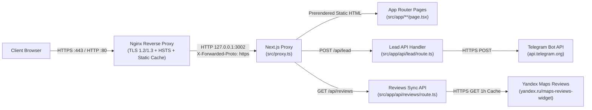

# Complete Project Documentation — "SHUMNO" Loft (`goodroom26.ru`)

> **Language / Язык:** English | [Русская версия (`DOCUMENTATION.ru.md`)](./DOCUMENTATION.ru.md)

---

## Table of Contents
1. [Project Overview](#1-project-overview)
2. [Technology Stack](#2-technology-stack)
3. [Architecture & Directory Structure](#3-architecture--directory-structure)
4. [Route Map & SEO Parity](#4-route-map--seo-parity)
5. [Design System, Dual-Mode Theming & UI Components](#5-design-system-dual-mode-theming--ui-components)
6. [Data Layer & Content Editing Guide](#6-data-layer--content-editing-guide)
7. [Lead Capture API, Live Yandex Reviews Sync & Telegram Integration](#7-lead-capture-api-live-yandex-reviews-sync--telegram-integration)
8. [HTTPS & Security Architecture](#8-https--security-architecture)
9. [Environment Variables & Local Development](#9-environment-variables--local-development)
10. [VPS Infrastructure, Git Branching & CI/CD](#10-vps-infrastructure-git-branching--cicd)
11. [Operations, Monitoring & Troubleshooting](#11-operations-monitoring--troubleshooting)

---

## 1. Project Overview

**"SHUMNO" (GoodRoom)** is the official website for a private event and party loft venue located in Pyatigorsk, Russia (`https://goodroom26.ru/`).

This repository contains the complete migration of the live site from **Tilda Personal** to a fully self-contained **Next.js 16 (App Router)** web application featuring a bespoke architectural UI redesign and a dual-mode semantic theme engine (Dark & Light).

### Core Objectives Achieved
- **100% Zero-Tilda & Zero-CDN Autonomy:** All 94 original high-resolution photos, brand assets, light/dark favicons, OpenGraph banners, 3D/SVG feature icons, and 14 variable `.woff2` font subsets (`Unbounded`, `Manrope`, and `Comfortaa`) are hosted locally under `public/`. Zero runtime requests are made to `tildacdn.com`, `tilda.cc`, or `fonts.googleapis.com`.
- **Architectural Dual-Mode Theme Engine (Dark & Light):** Semantic CSS token system with zero pure `#000000` or `#ffffff` (`Dark Architectural Lounge` `#0b0d10` by default and `Warm Architectural Stone` `#f2f2ec`), synchronous pre-hydration initialization (zero FOUC), and a reactive theme store powered by React 19 `useSyncExternalStore`.
- **Native Yandex Reviews Widget & Theme-Aware Yandex Maps:** Replaces Yandex's light-only white reviews `<iframe>` with a natively styled `YandexReviewsWidget` backed by cached live syncing via `GET /api/reviews` (1-hour cache + instant static snapshot fallback), while interactive Yandex Maps embeds dynamically switch vector tiles (`theme=dark` / `theme=light`) whenever the user toggles themes.
- **100% URL & SEO Parity:** Every legacy Tilda route — including all 6 event landing pages, the Tilda Store product route (`/tproduct/...`), Tilda Feeds blog post URLs (`/tpost/...`), `/contacts`, and `/offer` — is preserved verbatim so existing Yandex and Google search rankings suffer zero broken links.
- **Strict End-to-End HTTPS:** Multi-layer TLS enforcement across Nginx (TLS 1.2/1.3 + Let's Encrypt), Next.js 16 Proxy (`308` canonical HTTPS redirects), HSTS (`preload`), `Content-Security-Policy: upgrade-insecure-requests`, and `https://` across all canonical tags, sitemaps, JSON-LD schemas, and embedded Yandex widgets.
- **Interactive Tariff Calculator & Telegram Lead Delivery:** Global accessible booking modal with weekday/weekend hourly rate calculation and one-click phone capture forms connected via `POST /api/lead` to the Telegram Bot API over HTTPS.
- **Multi-Site VPS Deployment & Automated CI/CD:** Runs on Ubuntu 24.04 VPS (`201.8.90.190`) on dedicated port `3002` via `PM2` and `Nginx` alongside sibling Next.js services, with zero-touch SSH deployment on `main` via **GitHub Actions**.

---

## 2. Technology Stack

| Layer | Technology / Tool | Version / Details |
|---|---|---|
| Framework | **Next.js** (App Router, Turbopack) | `16.4.3` (`cacheComponents`, `partialPrefetching`) |
| UI Library | **React** | `19.3.0` (Server & Client Components, `useSyncExternalStore`) |
| Language | **TypeScript** | `^5` (`strict: true`) |
| Styling | **Tailwind CSS** | `^4` (`@tailwindcss/turbopack`, `@theme inline`) |
| Typography | **Unbounded** + **Manrope** (+ **Comfortaa**) | Self-hosted Variable WOFF2 subsets (Cyrillic + Latin) |
| Icons | **Tabler Icons** (`@tabler/icons-react`) | `^3.50.0` + custom Telegram / WhatsApp / Max brand icons |
| Linting | **ESLint** (`eslint-config-next`) | `^9` (`core-web-vitals` + `typescript`) |
| Runtime | **Node.js** | `22.x LTS` |
| Process Manager | **PM2** | `7.x` (port `3002`, autorestart, `512M` memory cap) |
| Reverse Proxy / SSL | **Nginx** + **Certbot (Let's Encrypt)** | HTTP/2, TLS 1.2/1.3, HSTS, static caching |
| CI/CD | **GitHub Actions** (`appleboy/ssh-action`) | Automated lint, build verification, and SSH deployment on `main` |
| Analytics & Maps | **Yandex Metrika** + **Yandex Maps** | Counter `102654634`, Organization ID `194341733073` (`theme=dark/light`) |

---

## 3. Architecture & Directory Structure

### Request & Data Flow



### Repository Structure

```text
goodroom/
├── .github/
│   └── workflows/
│       └── deploy.yml              # GitHub Actions CI/CD workflow (lint -> build -> SSH deploy on main)
├── docs/
│   ├── DOCUMENTATION.ru.md         # Complete documentation in Russian
│   └── DOCUMENTATION.en.md         # Complete documentation in English
├── nginx/
│   └── goodroom26.ru.conf          # Production Nginx virtual host (SSL, HTTP/2, 301, caching)
├── public/
│   ├── fonts/                      # Self-hosted Unbounded, Manrope & Comfortaa variable fonts (.woff2)
│   └── images/
│       ├── blog/                   # Blog post covers and inline photography
│       ├── brand/                  # Logo, light/dark favicons, apple-touch-icon, author avatar
│       ├── categories/             # 6 event category cards on the homepage
│       ├── contacts/               # Contacts page hero cover
│       ├── events/                 # Hero covers and 8-photo galleries for 6 event landing pages
│       ├── home/                   # Homepage hero, advantages photo, and viewing CTA cover
│       ├── icons/                  # 3D fluent icons and SVG amenity icons
│       ├── loft/                   # 8 main loft interior gallery photos
│       ├── og/                     # OpenGraph social preview banners
│       └── store/                  # 9 loft catalog slider photos
├── scripts/
│   └── setup-https.sh              # Automated Let's Encrypt issuance & Nginx SSL activation
├── src/
│   ├── app/
│   │   ├── api/
│   │   │   ├── lead/route.ts       # Server Route Handler for booking & callback leads (POST /api/lead)
│   │   │   └── reviews/route.ts    # Server Route Handler for live Yandex reviews (GET /api/reviews)
│   │   ├── blog/page.tsx           # Blog index page (/blog)
│   │   ├── children/page.tsx       # Kids party landing page (/children)
│   │   ├── contacts/page.tsx       # Contacts, theme-aware map & legal requisites (/contacts)
│   │   ├── corporative/page.tsx    # Corporate events landing page (/corporative)
│   │   ├── graduation/page.tsx     # Graduation party landing page (/graduation)
│   │   ├── happybirthday/page.tsx  # Birthday party landing page (/happybirthday)
│   │   ├── karaoke/page.tsx        # Private karaoke loft landing page (/karaoke)
│   │   ├── offer/page.tsx          # Public Offer contract + Appendices 1 & 2 (/offer)
│   │   ├── tpost/[slug]/page.tsx   # Prerendered blog article route (/tpost/...)
│   │   ├── tproduct/892542624922-loft-shumno/page.tsx # Loft product & inventory page
│   │   ├── wedding/page.tsx        # Intimate wedding landing page (/wedding)
│   │   ├── error.tsx               # Client error boundary page
│   │   ├── globals.css             # Tailwind v4, @font-face declarations, dark/light tokens, animations
│   │   ├── layout.tsx              # Root layout, zero-FOUC theme script, ModalProvider, Metrika
│   │   ├── not-found.tsx           # Custom 404 page
│   │   ├── page.tsx                # Homepage (12 sections) + EventVenue & FAQPage JSON-LD
│   │   ├── robots.ts               # Metadata route for /robots.txt
│   │   └── sitemap.ts              # Metadata route for /sitemap.xml
│   ├── components/
│   │   ├── ContactsMapSection.tsx  # Contact block + theme-aware Yandex Map iframe (dark/light)
│   │   ├── EventLandingView.tsx    # Shared architectural landing template for all 6 event pages
│   │   ├── FaqAccordion.tsx        # Accessible collapsible FAQ list
│   │   ├── FloatingMessengers.tsx  # Floating quick-contact speed dial (Call, Telegram, WhatsApp, Max)
│   │   ├── Footer.tsx              # Site footer with navigation, contacts, and IP requisites
│   │   ├── Header.tsx              # Sticky glass header with dropdown, ThemeToggle, and mobile drawer
│   │   ├── HeroQuickForm.tsx       # Above-the-fold phone capture & instant booking trigger
│   │   ├── Icons.tsx               # Unified icon registry (@tabler/icons-react + messenger logos)
│   │   ├── LoftCatalogCard.tsx     # Split sticky slider showcase with lightbox and tariff switcher
│   │   ├── ModalProvider.tsx       # Global booking calculator & callback modal
│   │   ├── OpenModalButton.tsx     # Client modal trigger usable inside Server Components
│   │   ├── PhotoGalleryGrid.tsx    # Responsive 4x2 photo grid with fullscreen lightbox
│   │   ├── ScrollToTop.tsx         # IntersectionObserver-driven scroll-to-top button (0 scroll listeners)
│   │   ├── ThemeToggle.tsx         # Segmented Dark / Light theme pill switcher
│   │   ├── YandexMetrika.tsx       # Non-blocking Yandex Metrika tag loader (lazyOnload)
│   │   └── YandexReviewsWidget.tsx # Natively styled theme-adaptive Yandex Maps reviews widget
│   ├── data/                       # Strongly-typed content, tariff, blog, and legal modules
│   ├── lib/
│   │   ├── phone.ts                # Russian (+7) phone formatter and validator
│   │   ├── theme.ts                # Reactive theme store (useSyncExternalStore + localStorage)
│   │   └── yandex-reviews.ts       # Static snapshot, HTML parser & 1h server cache for Yandex reviews
│   └── proxy.ts                    # Next.js 16 Proxy: HTTPS redirect, canonical host & HSTS
├── .env.example                    # Environment variable template
├── ecosystem.config.cjs            # PM2 process definition (port 3002)
├── eslint.config.mjs               # Flat ESLint configuration
├── next.config.ts                  # Next.js 16 & security headers configuration
├── package.json                    # Dependencies and npm scripts
├── README.md                       # Bilingual Quick-Start Guide (RU / EN)
└── tsconfig.json                   # TypeScript configuration
```

---

## 4. Route Map & SEO Parity

All content routes compile as **Static (`○`)** pages at build time (with **Partial Prerender `◐`** enabled on the dynamic blog route shell) for sub-10ms server response latency.

| Route Path | Render Mode | Purpose | Structured Data & SEO |
|---|---|---|---|
| `/` | Static (`○`) | Homepage (12 architectural sections) | `EventVenue` + `FAQPage` JSON-LD, OG `/images/og/home.png` |
| `/happybirthday` | Static (`○`) | Birthday party loft rental | Canonical `/happybirthday`, OG `/images/og/happybirthday.png` |
| `/graduation` | Static (`○`) | Graduation night loft rental | Canonical `/graduation`, OG `/images/og/graduation.png` |
| `/children` | Static (`○`) | Kids party loft rental | Canonical `/children`, OG `/images/og/children.png` |
| `/wedding` | Static (`○`) | Intimate wedding loft rental | Canonical `/wedding`, OG `/images/og/wedding.png` |
| `/corporative` | Static (`○`) | Corporate & team-building events | Canonical `/corporative`, OG `/images/og/corporative.png` |
| `/karaoke` | Static (`○`) | Private karaoke party loft | Canonical `/karaoke`, OG `/images/og/karaoke.png` |
| `/tproduct/892542624922-loft-shumno` | Static (`○`) | Loft catalog details & room inventory | `Product` + `AggregateOffer` JSON-LD (`1500–2500 RUB`) |
| `/blog` | Static (`○`) | Blog article index | Canonical `/blog` |
| `/tpost/loft-ili-kafe-gde-luchshe-provesti-den-rozhdeniya-v-pyatigorske` | Static (`○`) | Blog post: "Loft vs. Cafe Comparison" | `Article` JSON-LD, responsive comparison table |
| `/tpost/fe9irjign1-chto-takoe-loft-prostranstvo-i-pochemu-e` | Static (`○`) | Blog post: "What Is a Loft Space?" | `Article` JSON-LD |
| `/contacts` | Static (`○`) | Contacts, theme-aware map & legal requisites | Canonical `/contacts`, OG `/images/og/contacts.png` |
| `/offer` | Static (`○`) | Public Offer + Appendices 1 & 2 | Verbatim rental agreement, property list & rules |
| `/robots.txt` | Static (`○`) | Crawler rules | Allows `/`, disallows `/api/`, declares HTTPS `Host` & `Sitemap` |
| `/sitemap.xml` | Static (`○`) | XML sitemap for search engines | Strict `https://goodroom26.ru/...` URLs |
| `POST /api/lead` | Dynamic (`ƒ`) | Lead capture API endpoint | Validates phone & dispatches notification to Telegram Bot API |
| `GET /api/reviews` | Dynamic (`ƒ`) | Live Yandex Maps reviews sync endpoint | 1-hour cache (`s-maxage=3600`, `stale-while-revalidate=86400`) |

---

## 5. Design System, Dual-Mode Theming & UI Components

### Typography (`public/fonts/`, `src/app/globals.css`)
- **`Unbounded`** (`400..700`, `--font-display`) — bold architectural display grotesque used for `H1`–`H3` headings, area metrics, hourly rates, and Yandex Maps aggregate scores.
- **`Manrope`** (`400..700`, `--font-sans`) — clean geometric sans-serif used for body copy, navigation, tables, forms, and guest reviews.
- **`Comfortaa`** (`300..700`) — retained locally in `public/fonts/` for backward compatibility.

### Semantic Dual-Mode Palette (`src/app/globals.css`)
Pure `#000000` and `#ffffff` are intentionally avoided. Every surface, border, and text element references semantic CSS custom properties bound to `[data-theme="dark"]` (default) and `[data-theme="light"]`:

| Semantic Token | Dark Theme (`[data-theme="dark"]`, Default) | Light Theme (`[data-theme="light"]`) | Role |
|---|---|---|---|
| `--canvas` | `#0b0d10` (deep obsidian) | `#f2f2ec` (warm architectural stone) | Primary page background |
| `--surface` | `#12151a` | `#fafaf6` | Cards, modals, forms, reviews widget |
| `--surface-elevated` | `#181c23` | `#e7e7df` | Elevated pills, hover states, review CTA bar |
| `--surface-glass` | `rgba(11, 13, 16, 0.84)` | `rgba(242, 242, 236, 0.88)` | Frosted sticky header (`backdrop-filter: blur(18px)`) |
| `--ink` | `#f3f4f6` | `#111315` | Primary high-contrast foreground text |
| `--ink-muted` | `#a1a8b5` | `#4a515b` | Secondary body copy |
| `--ink-subtle` | `#7a8291` | `#666e7a` | Captions, review timestamps, metadata |
| `--hairline` / `--hairline-strong` | `rgba(243,244,246, 0.09 / 0.18)` | `rgba(17,19,21, 0.11 / 0.22)` | Crisp `1px` architectural hairlines |
| `--accent` / `--accent-hover` | `#3be85e` / `#2dd450` | `#3be85e` / `#2bc64b` | Brand CTA fills, rating stars, active theme pill |
| `--accent-text` | `#3be85e` | `#147a2e` | Accessible green text/links (WCAG AA compliant on warm stone) |

### Zero-FOUC Theme Initialization & Reactive Store
1. **Pre-Paint Script (`src/app/layout.tsx`)**: An inline synchronous `themeInitScript` inside `<head>` reads `localStorage.getItem('goodroom-theme')` before first paint and sets `data-theme="light"` or `data-theme="dark"` on `<html>`, preventing any Flash of Unstyled Content (FOUC).
2. **External Store (`src/lib/theme.ts`)**: `useTheme()` wraps React 19 `useSyncExternalStore` with a `MutationObserver` on `document.documentElement` (`data-theme`) and cross-tab `window` `storage` synchronization.
3. **Segmented Theme Switcher (`src/components/ThemeToggle.tsx`)**: Tactile segmented pill (`[ 🌙 Темная | ☀️ Светлая ]` plus `compact` icon mode for narrow mobile top bars), available in the desktop header, mobile sticky header, and mobile drawer (`Header.tsx`).
4. **Theme-Aware Yandex Maps (`src/components/ContactsMapSection.tsx`)**: Subscribes to `useTheme()` and passes `&theme=dark` or `&theme=light` (`key={theme}`) to Yandex Map Widget v1 (`yandex.ru/map-widget/v1/`), dynamically switching vector map tiles and floating controls across every page on the site.

### Component Reference (`src/components/`)
- **`ModalProvider.tsx`** — Global React Context provider and accessible (`role="dialog"`, `aria-modal="true"`, `Escape` & backdrop dismissal, input autofocus) modal supporting two modes:
  - `mode: "callback"` — Quick callback / loft viewing request (name, phone, offer consent).
  - `mode: "booking"` — Interactive booking calculator (Weekday `1,500 ₽/h` min 3h vs. Weekend `2,500 ₽/h` min 5h selector, hour stepper `−/+`, live estimated total in RUB, preferred date picker).
- **`OpenModalButton.tsx`** — Lightweight Client Component trigger allowing Server Components (`page.tsx`, blog posts, contacts) to open the lead modal while keeping page layouts purely server-rendered.
- **`Header.tsx`** — Sticky frosted-glass navigation bar with desktop "Formats" dropdown, amenities/blog/contacts links, `ThemeToggle`, click-to-call phone number, CTA button, and mobile drawer.
- **`Footer.tsx`** — Architectural site footer featuring venue summary, legal entity details (IP, INN, OGRNIP), event links, and legal navigation.
- **`ThemeToggle.tsx`** — Segmented Dark / Light theme switcher (`compact` and labeled modes).
- **`YandexReviewsWidget.tsx`** — Natively styled Yandex Maps reviews feed built with `--surface` / `--accent` tokens, `Unbounded` `4,8` aggregate score, star ratings, monogram avatars, expandable long reviews, `.reviews-scroll` thin scrollbar, and *"Leave a Review"* CTA bar.
- **`ContactsMapSection.tsx`** — Contact block with callback trigger, messenger buttons, and theme-aware HTTPS Yandex Map iframe (`theme=dark` / `theme=light`).
- **`HeroQuickForm.tsx`** — Above-the-fold phone capture & instant calculation form with live `+7 (000) 000-00-00` masking.
- **`LoftCatalogCard.tsx`** — Split sticky 9-photo product showcase with thumbnail strip, keyboard-navigable fullscreen lightbox (`←`, `→`, `Escape`), day-of-week tariff switcher, and venue specifications.
- **`EventLandingView.tsx`** — Shared architectural landing page view powering all 6 event pages (asymmetrical hero, 8-photo gallery with lightbox, amenities matrix, sibling format cross-links, and theme-aware map).
- **`PhotoGalleryGrid.tsx`** — Responsive `4x2` photo grid with hover zoom and fullscreen lightbox.
- **`FaqAccordion.tsx`** — Accessible collapsible FAQ list (`aria-expanded`).
- **`FloatingMessengers.tsx`** — Floating bottom-right quick-contact speed dial (Call, Telegram, WhatsApp, Max).
- **`ScrollToTop.tsx`** — Smooth scroll-to-top button driven by an `IntersectionObserver` sentinel (zero `window` scroll event listeners).
- **`YandexMetrika.tsx`** — Non-blocking Yandex Metrika tag loader (`strategy="lazyOnload"`).
- **`Icons.tsx`** — Typed `@tabler/icons-react` UI icon wrappers plus custom SVG icons for Telegram, WhatsApp, and Max.

---

## 6. Data Layer & Content Editing Guide

All copy, pricing, SEO metadata, and asset paths are decoupled from presentation components inside typed TypeScript modules in `src/data/` and `src/lib/`.

### Updating Contact Details, Messengers, or Analytics
Edit `SITE_CONFIG` in `src/data/site.ts`:
- `phoneDisplay` / `phoneHref` — Primary phone shown in header, contacts, and footer (`+7 (928) 020-10-01`).
- `messengerPhoneDisplay` / `messengerPhoneHref` — Secondary phone used for WhatsApp, Max, floating call button, and legal requisites (`+7 (968) 270-47-77`).
- `telegramUrl`, `whatsappUrl`, `maxUrl` — Messenger URLs.
- `yandexOrgId`, `yandexMapsOrgUrl`, `yandexMapIframeUrl`, `yandexReviewsIframeUrl` — Yandex Maps organization configuration (`194341733073`).
- `metrikaId` — Yandex Metrika counter ID (defaults to `102654634`).

### Updating Hourly Rates & Minimum Hours
Edit `LOFT_PRODUCT.editions` in `src/data/home.ts`:
- `weekday` (Mon–Thu): `price`, `priceFormatted`, `oldPrice`, `minHours`.
- `weekend` (Fri–Sun): `price`, `priceFormatted`, `oldPrice`, `minHours`.
Changes automatically propagate to the homepage catalog card, `/tproduct/892542624922-loft-shumno`, `AggregateOffer` JSON-LD, and the interactive booking calculator modal.

### Editing Event Landing Pages
Edit `EVENT_PAGES` in `src/data/events.ts` under the corresponding slug (`happybirthday`, `graduation`, `children`, `wedding`, `corporative`, `karaoke`).

### Publishing a New Blog Post
Prepend a new `BlogPost` entry to `BLOG_POSTS` in `src/data/blog.ts` (supports `paragraph`, `heading2`, `heading3`, `quote`, `bullets`, `image`, and `table` section blocks).
On the next build, Next.js automatically:
1. Prerenders `/tpost/<your-slug>` via `generateStaticParams()`;
2. Displays the article card on `/#blog` and `/blog`;
3. Adds the URL to `/sitemap.xml` and outputs `Article` JSON-LD.

### Updating Legal Offer Text, Room Inventory, or Rules
Edit `OFFER_DOCUMENT` in `src/data/offer.ts`:
- `sections` — Numbered rental contract clauses;
- `appendix1.rooms` — Room-by-room equipment list (also rendered on the product page);
- `appendix2` — Facility usage rules, cleaning fees, and prohibited actions.

---

## 7. Lead Capture API, Live Yandex Reviews Sync & Telegram Integration

### 7.1. Lead Capture Endpoint: `POST /api/lead` (`src/app/api/lead/route.ts`)

#### Request Payload Schema
```json
{
  "name": "Alexey",
  "phone": "+7 (928) 020-10-01",
  "date": "2026-11-20",
  "tariff": "Выходные (ПТ-ВС) (2 500 ₽/ч)",
  "hours": 5,
  "estimatedTotal": 12500,
  "comment": "Birthday party, 15 guests",
  "source": "Карточка лофта (Выходные (ПТ-ВС))"
}
```
`phone` is required and validated by `isValidRuPhone` (`src/lib/phone.ts`) for a complete 11-digit Russian phone number.

#### Response Codes
- `200 OK` — `{ "ok": true }` (lead delivered to Telegram over HTTPS, or logged to PM2 stdout if bot credentials are not configured yet).
- `400 Bad Request` — `{ "ok": false, "error": "Укажите корректный номер телефона" }`.
- `502 Bad Gateway` — Upstream Telegram API failure.

#### Connecting a Telegram Notification Bot
1. Create a bot via `@BotFather` in Telegram and copy `TELEGRAM_BOT_TOKEN`.
2. Add the bot to your managers' group chat (or message it directly) and obtain `TELEGRAM_CHAT_ID`.
3. Add both variables to `/var/www/goodroom/.env` on the VPS:
   ```env
   TELEGRAM_BOT_TOKEN=1234567890:AAH...
   TELEGRAM_CHAT_ID=-1001234567890
   ```
4. Reload PM2 with zero downtime:
   ```bash
   pm2 reload goodroom --update-env
   ```

### 7.2. Live Yandex Maps Reviews Sync: `GET /api/reviews` (`src/app/api/reviews/route.ts`)

Yandex's official `https://yandex.ru/maps-reviews-widget/194341733073?comments` iframe hardcodes a light-only `#fff` stylesheet with zero dark-mode support. To render real Yandex Maps reviews natively in both dark and light architectural themes:
1. At build/prerender time, `/` renders immediately with the verified static snapshot `FALLBACK_YANDEX_REVIEWS` (`src/lib/yandex-reviews.ts`), preserving `Static (○)` prerendering under `cacheComponents: true` with `0ms` blocking latency.
2. On mount, `YandexReviewsWidget` asynchronously fetches `GET /api/reviews`.
3. `getLiveYandexReviews()` fetches Yandex's SSR widget HTML (with a `4500ms` timeout), parses the live aggregate rating (`4,8`), review/rating counts, and review cards via `parseYandexReviewsWidgetHtml()`, caches the payload in memory for **1 hour**, and serves it with `Cache-Control: public, s-maxage=3600, stale-while-revalidate=86400` (gracefully falling back to `FALLBACK_YANDEX_REVIEWS` if Yandex is unreachable).

---

## 8. HTTPS & Security Architecture

HTTPS is enforced across four complementary layers:

1. **Layer 1 — Nginx TLS Termination (`nginx/goodroom26.ru.conf`)**:
   - Listens on ports `80` and `443` (`http2`, `TLSv1.2`, `TLSv1.3`).
   - All plain HTTP requests to `goodroom26.ru` and `www.goodroom26.ru` (except `/.well-known/acme-challenge/` for ACME HTTP-01 renewals) receive a `301` redirect to `https://goodroom26.ru$request_uri`.
   - Requests to `https://www.goodroom26.ru` receive a `301` redirect to `https://goodroom26.ru$request_uri`.
   - Forwards `X-Forwarded-Proto: https` to the Next.js upstream on `127.0.0.1:3002`.
2. **Layer 2 — Automated Let's Encrypt Issuance & Renewal (`scripts/setup-https.sh`)**:
   - Two-stage idempotent provisioning script: configures an HTTP-01 webroot (`/var/www/letsencrypt`), issues the certificate via `certbot certonly --webroot`, installs the hardened SSL virtual host, and enables `certbot.timer` for automatic 60-day renewals.
3. **Layer 3 — Next.js 16 Application Proxy (`src/proxy.ts`)**:
   - Inspects `X-Forwarded-Host` / `Host` and `X-Forwarded-Proto` in production. Any plain-HTTP domain request or `www.` request receives a `308 Permanent Redirect` to `https://goodroom26.ru`.
   - Intelligently exempts loopback addresses (`localhost`, `127.0.0.1`, `::1`) and raw IPv4 addresses (`201.8.90.190:3002`), ensuring local development, PM2/CI healthchecks, and direct IP previews work seamlessly.
   - Injects `Strict-Transport-Security: max-age=63072000; includeSubDomains; preload` and `Content-Security-Policy: upgrade-insecure-requests` on HTTPS responses.
4. **Layer 4 — Hardened Headers & URL Normalization (`next.config.ts`, `src/data/site.ts`)**:
   - Suppresses `X-Powered-By` (`poweredByHeader: false`).
   - Sends `X-Content-Type-Options: nosniff`, `Referrer-Policy: strict-origin-when-cross-origin`, and `X-Frame-Options: SAMEORIGIN` globally.
   - Normalizes `NEXT_PUBLIC_SITE_URL` to `https://` for all non-localhost origins.

---

## 9. Environment Variables & Local Development

### Environment Variables (`.env`)

| Variable | Required | Default | Description |
|---|---|---|---|
| `PORT` | No | `3002` | Port used by the production Next.js server |
| `NEXT_PUBLIC_SITE_URL` | No | `https://goodroom26.ru` | Canonical HTTPS base URL for metadata, OpenGraph, `sitemap.xml`, and JSON-LD |
| `ENFORCE_HTTPS` | No | `true` | Enables `308` HTTP→HTTPS & canonical domain redirects in `src/proxy.ts` |
| `TELEGRAM_BOT_TOKEN` | For Telegram | *(empty)* | Telegram Bot token from `@BotFather` |
| `TELEGRAM_CHAT_ID` | For Telegram | *(empty)* | Target Telegram chat or group ID for incoming leads |
| `NEXT_PUBLIC_YANDEX_METRIKA_ID` | No | `102654634` | Yandex Metrika counter ID |

### NPM Scripts (`package.json`)

```bash
# Install dependencies
npm install

# Start local development server (http://localhost:3000)
npm run dev

# Start local development server with trusted local HTTPS (https://localhost:3000)
npm run dev:https

# Run ESLint checks
npm run lint

# Build production bundle
npm run build

# Start production server on port 3002
npm run start -- -p 3002
```

---

## 10. VPS Infrastructure, Git Branching & CI/CD

### Multi-Site Isolation on VPS `201.8.90.190`

Multiple independent Next.js applications run side-by-side on the same server with complete isolation:

| Parameter | Site #1 (`hyzhinalesnika.ru`) | Site #2 (`goodroom26.ru`) |
|---|---|---|
| Application Directory | `/var/www/hyzhinalesnika` | `/var/www/goodroom` |
| PM2 Process Name | `hyzhinalesnika` (`id: 0`) | `goodroom` (`id: 1`) |
| Upstream Port | `3001` (`127.0.0.1:3001`) | `3002` (`0.0.0.0:3002`) |
| Nginx Virtual Host | `/etc/nginx/sites-enabled/hyzhinalesnika.ru` | `/etc/nginx/sites-enabled/goodroom26.ru` |
| Let's Encrypt Cert | `/etc/letsencrypt/live/hyzhinalesnika.ru/` | `/etc/letsencrypt/live/goodroom26.ru/` |
| GitHub Repository | `ZANYRI/hyzhinalesnika` | `ZANYRI/goodroom` |
| SSH Deploy Key Label | `github-actions-hyzhinalesnika` | `github-actions-goodroom` |

### DNS Configuration (Masterhost)
- **Authoritative Nameservers for `goodroom26.ru`:** `ns.masterhost.ru`, `ns1.masterhost.ru`, `ns2.masterhost.ru`.
- **Zone Records:**
  - `@` — Type `A` → `201.8.90.190`
  - `www` — Type `A` → `201.8.90.190`

### Branching Strategy & Production Promotion
- **`dev_danil` (and feature branches)** — active development and UI/UX iteration branches. Pushing to `origin/dev_danil` backs up work on GitHub **without** deploying to the live VPS.
- **`main`** — production branch. Every push or merge into `main` triggers automated CI/CD deployment to `201.8.90.190:3002`.

To promote tested changes from `dev_danil` to production:
```bash
git checkout main
git pull origin main
git merge dev_danil
git push origin main
```

### Automated GitHub Actions CI/CD (`.github/workflows/deploy.yml`)
Triggered automatically on every `push` to `main` (and manually via **Run workflow**):
1. Provisions Node.js `22` on Ubuntu in GitHub Actions and runs `npm ci`, `npm run lint`, and `npm run build` as a quality gate. If lint or TypeScript fails, deployment aborts safely before touching the VPS.
2. Connects to `201.8.90.190` over SSH using repository secrets (`VPS_HOST`, `VPS_USER`, `VPS_APP_DIR`, `VPS_SSH_KEY`), updates `/var/www/goodroom` (`git fetch` + `git reset --hard origin/main`), runs `npm ci` and `NODE_OPTIONS="--max-old-space-size=1536" npm run build`, and reloads PM2 (`pm2 startOrReload ecosystem.config.cjs --update-env` + `pm2 save`).
3. Executes an automated **Healthcheck** (`curl -fsS http://127.0.0.1:3002`) with automatic PM2 log dumping on failure.

---

## 11. Operations, Monitoring & Troubleshooting

### Common Server Administration Commands

```bash
# View status, uptime, CPU, and RAM usage of all PM2 apps
pm2 list

# Tail GoodRoom application logs
pm2 logs goodroom --lines 50

# Reload GoodRoom after editing /var/www/goodroom/.env
pm2 reload goodroom --update-env
pm2 save

# Validate Nginx syntax and reload gracefully
nginx -t && systemctl reload nginx

# Inspect installed Let's Encrypt SSL certificates and expiry dates
certbot certificates

# Dry-run test automatic SSL renewal
certbot renew --dry-run

# Manually run HTTPS provisioning for goodroom26.ru
bash /var/www/goodroom/scripts/setup-https.sh goodroom26@mail.ru
```

### Troubleshooting Guide
1. **Form submissions succeed on the website, but no Telegram message arrives:**
   - Verify `TELEGRAM_BOT_TOKEN` and `TELEGRAM_CHAT_ID` are set in `/var/www/goodroom/.env`.
   - Run `pm2 reload goodroom --update-env` so PM2 picks up updated `.env` values.
   - Check `pm2 logs goodroom --lines 50` — all submissions and upstream Telegram API responses are logged with `[GoodRoom Lead]`.
2. **Rolling back a production deployment:**
   - Run `git revert HEAD && git push origin main` on `main`; GitHub Actions will rebuild and redeploy the previous stable state automatically.
3. **Checking DNS propagation & automatic HTTPS activation:**
   - Run `dig @1.1.1.1 +short goodroom26.ru A` on the VPS (should return `201.8.90.190`). Check `/var/log/goodroom-https-auto.log` for automatic SSL issuance progress.
