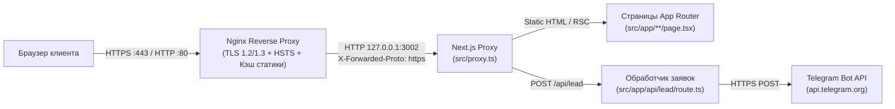

# Полная документация проекта «ШУМНО» (`goodroom26.ru`)

> **Язык / Language:** Русский | [English Version (`DOCUMENTATION.en.md`)](./DOCUMENTATION.en.md)

---

## Содержание
1. [Обзор проекта](#1-обзор-проекта)
2. [Технологический стек](#2-технологический-стек)
3. [Архитектура и структура проекта](#3-архитектура-и-структура-проекта)
4. [Карта маршрутов и SEO](#4-карта-маршрутов-и-seo)
5. [Дизайн-система и UI-компоненты](#5-дизайн-система-и-ui-компоненты)
6. [Слой данных и редактирование контента](#6-слой-данных-и-редактирование-контента)
7. [API заявок и интеграция с Telegram](#7-api-заявок-и-интеграция-с-telegram)
8. [Архитектура HTTPS и информационной безопасности](#8-архитектура-https-и-информационной-безопасности)
9. [Переменные окружения и локальная разработка](#9-переменные-окружения-и-локальная-разработка)
10. [Серверная инфраструктура (VPS), мультисайтовый режим и CI/CD](#10-серверная-инфраструктура-vps-мультисайтовый-режим-и-cicd)
11. [Эксплуатация, мониторинг и устранение неполадок](#11-эксплуатация-мониторинг-и-устранение-неполадок)

---

## 1. Обзор проекта

**«ШУМНО» (GoodRoom)** — официальный веб-сайт лофт-пространства для вечеринок и мероприятий в г. Пятигорске (`https://goodroom26.ru/`).

Проект представляет собой полную миграцию сайта с конструктора **Tilda Personal** на автономное веб-приложение **Next.js 16 (App Router)**.

### Ключевые задачи, решённые при миграции:
- **100% независимость от Tilda и сторонних CDN:** все 94 изображения, логотипы, фавиконки, OpenGraph-баннеры, SVG/3D-иконки и 6 начертаний шрифта `Comfortaa` (`.woff2`) хранятся локально в директории `public/`. Запросы к `tildacdn.com`, `tilda.cc` и `fonts.googleapis.com` полностью исключены.
- **100% сохранение URL-структуры и SEO:** сохранены все оригинальные адреса страниц мероприятий, карточки товара Tilda Store (`/tproduct/...`), статей блога Tilda Feeds (`/tpost/...`), контактов и публичной оферты — поисковый трафик из Яндекса и Google не теряет индексацию.
- **Строгий сквозной HTTPS:** принудительное шифрование на уровне Nginx (TLS 1.2/1.3 + Let's Encrypt), Next.js Proxy (`308` редиректы), HSTS, `Content-Security-Policy: upgrade-insecure-requests` и `https://` во всех метаданных, схемах JSON-LD и виджетах.
- **Интерактивное бронирование и Telegram-уведомления:** модальный калькулятор расчёта стоимости аренды (будни / выходные, минимальное число часов) и быстрая форма захвата телефона с мгновенной отправкой заявок в Telegram.
- **Мультисайтовый деплой и CI/CD:** параллельная работа на одном VPS (`201.8.90.190`) на изолированном порту `3002` под управлением `PM2` и `Nginx` с автодеплоем через **GitHub Actions**.

---

## 2. Технологический стек

| Категория | Технология / Инструмент | Версия / Примечание |
|---|---|---|
| Фреймворк | **Next.js** (App Router, Turbopack) | `16.4.3` (`cacheComponents`, `partialPrefetching`) |
| UI-библиотека | **React** | `19.3.0` (Server & Client Components) |
| Язык | **TypeScript** | `^5` (`strict: true`) |
| Стилизация | **Tailwind CSS** | `^4` (`@tailwindcss/turbopack`) |
| Типографика | **Comfortaa** (Variable WOFF2) | Локальный self-hosted (`300..700`, кириллица + латиница) |
| Линтинг | **ESLint** (`eslint-config-next`) | `^9` (`core-web-vitals` + `typescript`) |
| Среда выполнения | **Node.js** | `22.x LTS` |
| Менеджер процессов | **PM2** | `7.x` (порт `3002`, авторестарт, лимит `512M`) |
| Веб-сервер / SSL | **Nginx** + **Certbot (Let's Encrypt)** | Reverse proxy, HTTP/2, TLS 1.2/1.3, HSTS |
| CI/CD | **GitHub Actions** (`appleboy/ssh-action`) | Автоматическая сборка, тесты и выкатка при `push` в `main` |
| Аналитика и карты | **Яндекс.Метрика** + **Яндекс Карты** | Счётчик `102654634`, организация `194341733073` |

---

## 3. Архитектура и структура проекта

### Схема прохождения запросов



### Дерево директорий репозитория

```text
goodroom/
├── .github/
│   └── workflows/
│       └── deploy.yml              # GitHub Actions CI/CD пайплайн (lint -> build -> SSH deploy)
├── docs/
│   ├── DOCUMENTATION.ru.md         # Полная документация на русском языке
│   └── DOCUMENTATION.en.md         # Полная документация на английском языке
├── nginx/
│   └── goodroom26.ru.conf          # Продакшен-конфигурация Nginx (SSL, HTTP/2, 301, кэш)
├── public/
│   ├── fonts/                      # Локальные файлы шрифта Comfortaa (.woff2)
│   └── images/
│       ├── blog/                   # Обложки и иллюстрации статей блога
│       ├── brand/                  # Логотип, фавиконки (light/dark), apple-touch-icon, аватар
│       ├── categories/             # 6 карточек форматов мероприятий на главной
│       ├── contacts/               # Обложка страницы контактов
│       ├── events/                 # Hero-обложки и фотогалереи 6 посадочных страниц
│       ├── home/                   # Обложки первого экрана, блока преимуществ и просмотра
│       ├── icons/                  # 3D-иконки преимуществ и SVG-иконки оснащения
│       ├── loft/                   # 8 фотографий основной галереи лофта
│       ├── og/                     # OpenGraph-баннеры для соцсетей и мессенджеров
│       └── store/                  # 9 фотографий слайдера карточки лофта
├── scripts/
│   └── setup-https.sh              # Автоматический выпуск SSL Let's Encrypt и настройка Nginx
├── src/
│   ├── app/
│   │   ├── api/lead/route.ts       # Серверный API-эндпоинт приёма заявок (POST /api/lead)
│   │   ├── blog/page.tsx           # Разводящая страница блога (/blog)
│   │   ├── children/page.tsx       # Лендинг «Детский праздник» (/children)
│   │   ├── contacts/page.tsx       # Страница контактов и реквизитов (/contacts)
│   │   ├── corporative/page.tsx    # Лендинг «Корпоратив» (/corporative)
│   │   ├── graduation/page.tsx     # Лендинг «Выпускной» (/graduation)
│   │   ├── happybirthday/page.tsx  # Лендинг «День рождения» (/happybirthday)
│   │   ├── karaoke/page.tsx        # Лендинг «Караоке» (/karaoke)
│   │   ├── offer/page.tsx          # Публичная оферта + Приложения № 1 и № 2 (/offer)
│   │   ├── tpost/[slug]/page.tsx   # Динамический маршрут статей блога (/tpost/...)
│   │   ├── tproduct/892542624922-loft-shumno/page.tsx # Карточка лофта (/tproduct/...)
│   │   ├── wedding/page.tsx        # Лендинг «Свадьба» (/wedding)
│   │   ├── error.tsx               # Глобальный обработчик ошибок рендеринга
│   │   ├── globals.css             # Tailwind v4, @font-face, цветовые токены, анимации
│   │   ├── layout.tsx              # Корневой layout, SEO по умолчанию, провайдер модалок
│   │   ├── not-found.tsx           # Кастомная страница 404
│   │   ├── page.tsx                # Главная страница (/) + JSON-LD EventVenue & FAQPage
│   │   ├── robots.ts               # Генератор /robots.txt
│   │   └── sitemap.ts              # Генератор /sitemap.xml
│   ├── components/                 # Клиентские и серверные UI-компоненты
│   ├── data/                       # Типизированные файлы контента, цен, статей и оферты
│   ├── lib/
│   │   └── phone.ts                # Форматирование и валидация российских номеров (+7)
│   └── proxy.ts                    # Next.js 16 Proxy: контроль HTTPS, канонического домена и HSTS
├── .env.example                    # Шаблон переменных окружения
├── ecosystem.config.cjs            # Конфигурация PM2 (порт 3002)
├── eslint.config.mjs               # Правила ESLint
├── next.config.ts                  # Конфигурация Next.js 16 и заголовков безопасности
├── package.json                    # Зависимости и npm-скрипты
├── README.md                       # Краткое двуязычное руководство (RU / EN)
└── tsconfig.json                   # Конфигурация TypeScript
```

---

## 4. Карта маршрутов и SEO

Все контентные маршруты собираются в режиме **Static Prerendering (`○`)**, обеспечивая мгновенный ответ сервера (`TTFB < 10 мс`).

| Маршрут (URL) | Тип рендеринга | Назначение | Структурированные данные / SEO |
|---|---|---|---|
| `/` | Static (`○`) | Главная страница (11 секций) | `EventVenue` + `FAQPage` JSON-LD, OG `/images/og/home.png` |
| `/happybirthday` | Static (`○`) | Аренда лофта на День рождения | Канонический URL, OG `/images/og/happybirthday.png` |
| `/graduation` | Static (`○`) | Выпускной вечер в лофте | Канонический URL, OG `/images/og/graduation.png` |
| `/children` | Static (`○`) | Детский праздник в лофте | Канонический URL, OG `/images/og/children.png` |
| `/wedding` | Static (`○`) | Камерная свадьба в лофте | Канонический URL, OG `/images/og/wedding.png` |
| `/corporative` | Static (`○`) | Корпоратив и тимбилдинг | Канонический URL, OG `/images/og/corporative.png` |
| `/karaoke` | Static (`○`) | Лофт с профессиональным караоке | Канонический URL, OG `/images/og/karaoke.png` |
| `/tproduct/892542624922-loft-shumno` | Static (`○`) | Карточка лофта и оснащение залов | `Product` + `AggregateOffer` JSON-LD (`1500–2500 RUB`) |
| `/blog` | Static (`○`) | Список всех статей блога | Канонический URL `/blog` |
| `/tpost/loft-ili-kafe-gde-luchshe-provesti-den-rozhdeniya-v-pyatigorske` | Static (`○`) | Статья «Лофт или кафе: честное сравнение» | `Article` JSON-LD, таблица сравнения |
| `/tpost/fe9irjign1-chto-takoe-loft-prostranstvo-i-pochemu-e` | Static (`○`) | Статья «Что такое лофт-пространство» | `Article` JSON-LD |
| `/contacts` | Static (`○`) | Контакты, карта и реквизиты ИП | Канонический URL, OG `/images/og/contacts.png` |
| `/offer` | Static (`○`) | Публичная оферта + Приложения № 1, № 2 | Полный юридический текст договора аренды |
| `/robots.txt` | Static (`○`) | Правила индексации поисковыми роботами | Разрешает `/`, закрывает `/api/`, указывает `Host` и `Sitemap` |
| `/sitemap.xml` | Static (`○`) | XML-карта всех страниц и статей | Строгие `https://goodroom26.ru/...` ссылки |
| `POST /api/lead` | Dynamic (`ƒ`) | Приём заявок на бронь и обратный звонок | Валидация телефона + отправка в Telegram Bot API |

---

## 5. Дизайн-система и UI-компоненты

### Цветовая палитра (`src/app/globals.css`)
- `--bg-noir` (`#000000`) — фирменный угольно-чёрный фон шапки, подвала, преимуществ, главной фотогалереи и блока контактов.
- `--bg-surface-dark` (`#121212`) — карточки на тёмных секциях.
- `--bg-light` (`#ffffff`) / `--bg-muted` (`#f3f3f3`) — чередующиеся светлые секции для комфортного чтения.
- `--neon` (`#43ff57`) / `--neon-hover` (`#33d744`) — фирменный неоново-зелёный акцент главных CTA-кнопок и активных пунктов навигации.
- `--coral` (`#ff8562`) — акцент стоимости часа и текстовых ссылок.
- `--sale` (`#ff4a4a`) — бейдж акции `SALE` и индикаторы обязательных полей.
- `--blog-green` (`#36b644`) — заголовки карточек блога и маркеры списков.

### Справочник компонентов (`src/components/`)
- **`ModalProvider.tsx`** — глобальный React Context провайдер и доступное (`role="dialog"`, `aria-modal="true"`, закрытие по `Escape` и клику по фону, автофокус поля) модальное окно в двух режимах:
  - `mode: "callback"` — быстрая заявка / запись на просмотр (имя + телефон + согласие с офертой).
  - `mode: "booking"` — интерактивный калькулятор бронирования (выбор тарифа Будни `1 500 ₽/ч` от 3 ч / Выходные `2 500 ₽/ч` от 5 ч, счётчик часов `−/+`, автоматический расчёт предварительной суммы, выбор даты).
- **`OpenModalButton.tsx`** — лёгкая клиентская кнопка-триггер, позволяющая вызывать модальное окно из серверных страниц (`Server Components`) без перевода всей страницы в клиентский бандл.
- **`Header.tsx`** — липкая (`sticky top-0`) шапка с выпадающим меню «Мероприятия», ссылками на блог и контакты, иконками Telegram / WhatsApp / Max, телефоном, CTA-кнопкой и адаптивным мобильным меню (drawer).
- **`Footer.tsx`** — подвал сайта с описанием лофта, реквизитами ИП (ИНН, ОГРНИП), навигацией по форматам мероприятий и юридическими ссылками.
- **`HeroQuickForm.tsx`** — встроенная форма быстрого бронирования в один клик на первом экране главной страницы с автоформатированием номера `+7 (000) 000-00-00`.
- **`LoftCatalogCard.tsx`** — карточка лофта с интерактивным слайдером на 9 фото, миниатюрами, полноэкранным лайтбоксом (поддержка клавиш `←`, `→`, `Escape`), переключателем тарифов дня недели и характеристиками зала.
- **`EventLandingView.tsx`** — единый переиспользуемый шаблон для всех 6 посадочных страниц мероприятий (обложка с бейджем и буллитами, тематическая галерея с лайтбоксом, блок «Всё включено», перелинковка с другими форматами и карта).
- **`PhotoGalleryGrid.tsx`** — адаптивная сетка фотографий `4x2` с плавным зумом и полноэкранным лайтбоксом.
- **`FaqAccordion.tsx`** — доступный аккордеон часто задаваемых вопросов (`aria-expanded`).
- **`ContactsMapSection.tsx`** — блок контактов с кнопкой обратного звонка, ссылками на мессенджеры и интерактивной HTTPS Яндекс Картой.
- **`FloatingMessengers.tsx`** — плавающая кнопка быстрой связи в правом нижнем углу (звонок, Telegram, WhatsApp, Max).
- **`ScrollToTop.tsx`** — кнопка плавного возврата к началу страницы (появляется после прокрутки на `500px`).
- **`YandexMetrika.tsx`** — клиентский загрузчик счётчика Яндекс.Метрики (`strategy="lazyOnload"`, не блокирует LCP/FCP).
- **`Icons.tsx`** — набор чистых векторных SVG-иконок интерфейса и мессенджеров.

---

## 6. Слой данных и редактирование контента

Весь текстовый контент, цены и пути к фото вынесены из разметки в строго типизированные модули в `src/data/`.

### Как изменить телефоны, адрес или ссылки на мессенджеры
Отредактируйте `src/data/site.ts` (`SITE_CONFIG`):
- `phoneDisplay` / `phoneHref` — основной номер в шапке, контактах и подвале (`+7 (928) 020-10-01`).
- `messengerPhoneDisplay` / `messengerPhoneHref` — номер для плавающей кнопки звонка, WhatsApp и реквизитов (`+7 (968) 270-47-77`).
- `telegramUrl`, `whatsappUrl`, `maxUrl` — прямые ссылки на мессенджеры.
- `metrikaId` — ID счётчика Яндекс.Метрики (по умолчанию `102654634`).

### Как изменить цены и условия тарифов
Отредактируйте массив `LOFT_PRODUCT.editions` в `src/data/home.ts`:
- Тариф `weekday` (Будни ПН–ЧТ): `price`, `priceFormatted`, `oldPrice`, `minHours`.
- Тариф `weekend` (Выходные ПТ–ВС): `price`, `priceFormatted`, `oldPrice`, `minHours`.
Изменения автоматически обновят карточку на главной, страницу `/tproduct/892542624922-loft-shumno`, JSON-LD разметку и калькулятор в модальном окне.

### Как редактировать страницы мероприятий
Отредактируйте объект `EVENT_PAGES` в `src/data/events.ts` по ключу нужной страницы (`happybirthday`, `graduation`, `children`, `wedding`, `corporative`, `karaoke`).

### Как добавить новую статью в блог
Добавьте новый объект `BlogPost` в начало массива `BLOG_POSTS` в `src/data/blog.ts` (поддерживаются блоки `paragraph`, `heading2`, `heading3`, `quote`, `bullets`, `image`, `table`).
При следующей сборке Next.js автоматически:
1. Сгенерирует статическую страницу `/tpost/<ваш-slug>` через `generateStaticParams()`;
2. Выведет карточку статьи на главной странице (`/#blog`) и на `/blog`;
3. Добавит ссылку на статью в `/sitemap.xml` и сгенерирует `Article` JSON-LD.

### Как изменить текст оферты, перечень имущества или штрафы
Отредактируйте `OFFER_DOCUMENT` в `src/data/offer.ts`:
- `sections` — основные пункты договора;
- `appendix1.rooms` — покомнатный перечень имущества (также отображается на странице карточки лофта);
- `appendix2` — правила пользования помещением и список запретов.

---

## 7. API заявок и интеграция с Telegram

Эндпоинт: **`POST /api/lead`** (`src/app/api/lead/route.ts`).

### Формат входного JSON-запроса
```json
{
  "name": "Алексей",
  "phone": "+7 (928) 020-10-01",
  "date": "2026-11-20",
  "tariff": "Выходные (ПТ–ВС) (2 500 ₽/ч)",
  "hours": 5,
  "estimatedTotal": 12500,
  "comment": "День рождения, 15 гостей",
  "source": "Карточка лофта (Выходные (ПТ–ВС))"
}
```
Обязательное поле — `phone` (проверяется функцией `isValidRuPhone` из `src/lib/phone.ts`: 11 цифр российского номера).

### Ответы API
- `200 OK` — `{ "ok": true }` (заявка успешно принята и отправлена в Telegram либо записана в серверный журнал PM2, если токен бота ещё не задан).
- `400 Bad Request` — `{ "ok": false, "error": "Укажите корректный номер телефона" }`.
- `502 Bad Gateway` — ошибка на стороне Telegram API (клиенту предлагается написать напрямую в WhatsApp или позвонить).

### Подключение Telegram-бота для уведомлений
1. Создайте бота в Telegram через `@BotFather` и скопируйте `TELEGRAM_BOT_TOKEN`.
2. Добавьте бота в рабочую группу менеджеров (или напишите ему в личные сообщения) и узнайте ID чата (`TELEGRAM_CHAT_ID`).
3. На сервере пропишите значения в `/var/www/goodroom/.env`:
   ```env
   TELEGRAM_BOT_TOKEN=1234567890:AAH...
   TELEGRAM_CHAT_ID=-1001234567890
   ```
4. Примените переменные без простоя:
   ```bash
   pm2 reload goodroom --update-env
   ```

---

## 8. Архитектура HTTPS и информационной безопасности

В проекте реализована четырёхуровневая защита HTTPS:

1. **Уровень 1 — Nginx TLS Termination (`nginx/goodroom26.ru.conf`)**:
   - Принимает трафик на портах `80` и `443` (`http2`, `TLSv1.2`, `TLSv1.3`).
   - Все запросы на `http://goodroom26.ru` и `http://www.goodroom26.ru` (кроме `/.well-known/acme-challenge/` для продления сертификата) получают жёсткий `301` редирект на `https://goodroom26.ru$request_uri`.
   - Запросы на `https://www.goodroom26.ru` получают `301` редирект на канонический домен `https://goodroom26.ru$request_uri`.
   - Передаёт в Next.js заголовок `X-Forwarded-Proto: https`.
2. **Уровень 2 — Автоматический выпуск и продление Let's Encrypt (`scripts/setup-https.sh`)**:
   - Скрипт в два этапа поднимает webroot `/var/www/letsencrypt`, выпускает сертификат через `certbot certonly --webroot`, устанавливает финальный HTTPS-конфиг и активирует системный таймер `certbot.timer` для автоматического продления сертификата каждые 60 дней.
3. **Уровень 3 — Прикладной прокси Next.js 16 (`src/proxy.ts`)**:
   - В production-режиме проверяет домены по `Host` / `X-Forwarded-Host` и протокол по `X-Forwarded-Proto`. Если запрос пришёл на домен по `http` или с префиксом `www.`, возвращает `308 Permanent Redirect` на `https://goodroom26.ru`.
   - Интеллектуально пропускает локальные адреса (`localhost`, `127.0.0.1`, `::1`) и прямые IPv4-обращения (`201.8.90.190:3002`), благодаря чему работают локальная разработка, healthcheck-проверки PM2/CI и прямой предпросмотр по IP.
   - На все HTTPS-ответы навешивает заголовки `Strict-Transport-Security: max-age=63072000; includeSubDomains; preload` и `Content-Security-Policy: upgrade-insecure-requests`.
4. **Уровень 4 — Глобальные заголовки и чистота ссылок (`next.config.ts`)**:
   - Скрыт заголовок `X-Powered-By` (`poweredByHeader: false`).
   - Везде присутствуют `X-Content-Type-Options: nosniff`, `Referrer-Policy: strict-origin-when-cross-origin`, `X-Frame-Options: SAMEORIGIN`.
   - В `src/data/site.ts` значение `NEXT_PUBLIC_SITE_URL` принудительно нормализуется к `https://` для любых внешних доменов.

---

## 9. Переменные окружения и локальная разработка

### Переменные окружения (`.env`)

| Переменная | Обязательна | По умолчанию | Описание |
|---|---|---|---|
| `PORT` | Нет | `3002` | Порт запуска production-сервера Next.js |
| `NEXT_PUBLIC_SITE_URL` | Нет | `https://goodroom26.ru` | Канонический HTTPS URL для SEO, OpenGraph, `sitemap.xml` и JSON-LD |
| `ENFORCE_HTTPS` | Нет | `true` | Включает принудительный `308` редирект на HTTPS в `src/proxy.ts` |
| `TELEGRAM_BOT_TOKEN` | Для Telegram | *(пусто)* | Токен Telegram-бота от `@BotFather` |
| `TELEGRAM_CHAT_ID` | Для Telegram | *(пусто)* | ID чата или группы получателей заявок |
| `NEXT_PUBLIC_YANDEX_METRIKA_ID` | Нет | `102654634` | Номер счётчика Яндекс.Метрики |

### Команды разработки (`package.json`)

```bash
# Установка зависимостей
npm install

# Локальный сервер разработки (http://localhost:3000)
npm run dev

# Локальный сервер разработки с локальным HTTPS-сертификатом (https://localhost:3000)
npm run dev:https

# Проверка кода линтером ESLint
npm run lint

# Сборка оптимизированной production-версии
npm run build

# Запуск собранной production-версии на порту 3002
npm run start -- -p 3002
```

---

## 10. Серверная инфраструктура (VPS), мультисайтовый режим и CI/CD

### Таблица изоляции проектов на VPS `201.8.90.190`

На сервере параллельно работают несколько независимых Next.js-приложений:

| Параметр | Сайт № 1 (`hyzhinalesnika.ru`) | Сайт № 2 (`goodroom26.ru`) |
|---|---|---|
| Рабочая директория | `/var/www/hyzhinalesnika` | `/var/www/goodroom` |
| Имя процесса в PM2 | `hyzhinalesnika` (`id: 0`) | `goodroom` (`id: 1`) |
| Внутренний порт | `3001` (`127.0.0.1:3001`) | `3002` (`0.0.0.0:3002`) |
| Виртуальный хост Nginx | `/etc/nginx/sites-enabled/hyzhinalesnika.ru` | `/etc/nginx/sites-enabled/goodroom26.ru` |
| Сертификат Let's Encrypt | `/etc/letsencrypt/live/hyzhinalesnika.ru/` | `/etc/letsencrypt/live/goodroom26.ru/` |
| GitHub-репозиторий | `ZANYRI/hyzhinalesnika` | `ZANYRI/goodroom` |
| Ключ в `authorized_keys` | `github-actions-hyzhinalesnika` | `github-actions-goodroom` |

### Настройки DNS (Masterhost)
- **NS-серверы домена `goodroom26.ru`:** `ns.masterhost.ru`, `ns1.masterhost.ru`, `ns2.masterhost.ru` (галочка «Прописать NS-серверы Мастерхост»).
- **DNS-записи зоны `goodroom26.ru`:**
  - `@` — тип `A` → `201.8.90.190`
  - `www` — тип `A` → `201.8.90.190`

### Автоматический CI/CD пайплайн (`.github/workflows/deploy.yml`)
При каждом `git push` в ветку `main` (а также вручную через кнопку **Run workflow** во вкладке Actions на GitHub) выполняются шаги:
1. Поднимается чистое окружение Ubuntu + Node.js `22` на GitHub Runners.
2. Выполняются `npm ci`, `npm run lint` и `npm run build` — если в коде есть синтаксическая или типовая ошибка, деплой останавливается и боевой сервер не затрагивается.
3. По SSH (с использованием секретов `VPS_HOST`, `VPS_USER`, `VPS_APP_DIR`, `VPS_SSH_KEY`) обновляется код в `/var/www/goodroom` (`git fetch` + `git reset --hard origin/main`), устанавливаются зависимости, собирается проект (`NODE_OPTIONS="--max-old-space-size=1536" npm run build`) и выполняется бесшовная перезагрузка `pm2 startOrReload ecosystem.config.cjs --update-env`.
4. Выполняется автоматический **Healthcheck** (`curl -fsS http://127.0.0.1:3002`). При неуспехе в лог GitHub Actions выводятся последние 30 строк журнала PM2.

---

## 11. Эксплуатация, мониторинг и устранение неполадок

### Полезные команды на VPS

```bash
# Статус всех запущенных сайтов и потребление памяти/CPU
pm2 list

# Просмотр логов сайта goodroom в реальном времени
pm2 logs goodroom --lines 50

# Перезапуск приложения после правки файла /var/www/goodroom/.env
pm2 reload goodroom --update-env
pm2 save

# Проверка конфигурации и перезагрузка Nginx
nginx -t && systemctl reload nginx

# Проверка статуса и сроков действия SSL-сертификатов
certbot certificates

# Тестовая проверка автопродления SSL-сертификатов
certbot renew --dry-run

# Ручной запуск выпуска/обновления HTTPS-конфига для goodroom26.ru
bash /var/www/goodroom/scripts/setup-https.sh goodroom26@mail.ru
```

### Частые ситуации и решения
1. **Заявки с сайта отправляются, но не приходят в Telegram:**
   - Проверьте, заполнены ли `TELEGRAM_BOT_TOKEN` и `TELEGRAM_CHAT_ID` в `/var/www/goodroom/.env`.
   - Убедитесь, что после редактирования `.env` была выполнена команда `pm2 reload goodroom --update-env`.
   - Посмотрите лог `pm2 logs goodroom --lines 50` — все заявки без токена или ошибки Telegram API подробно логируются с префиксом `[GoodRoom Lead]`.
2. **Нужно откатить сайт на предыдущий коммит:**
   - Сделайте `git revert HEAD && git push origin main` локально — GitHub Actions автоматически соберёт и раскатает предыдущую стабильную версию.
3. **Проверка обновления DNS после смены NS-серверов:**
   - Выполните на сервере `dig @1.1.1.1 +short goodroom26.ru A` — должен вернуться адрес `201.8.90.190`. Лог автоматического активатора HTTPS находится в `/var/log/goodroom-https-auto.log`.
